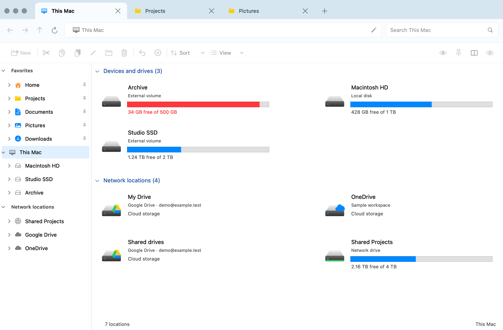
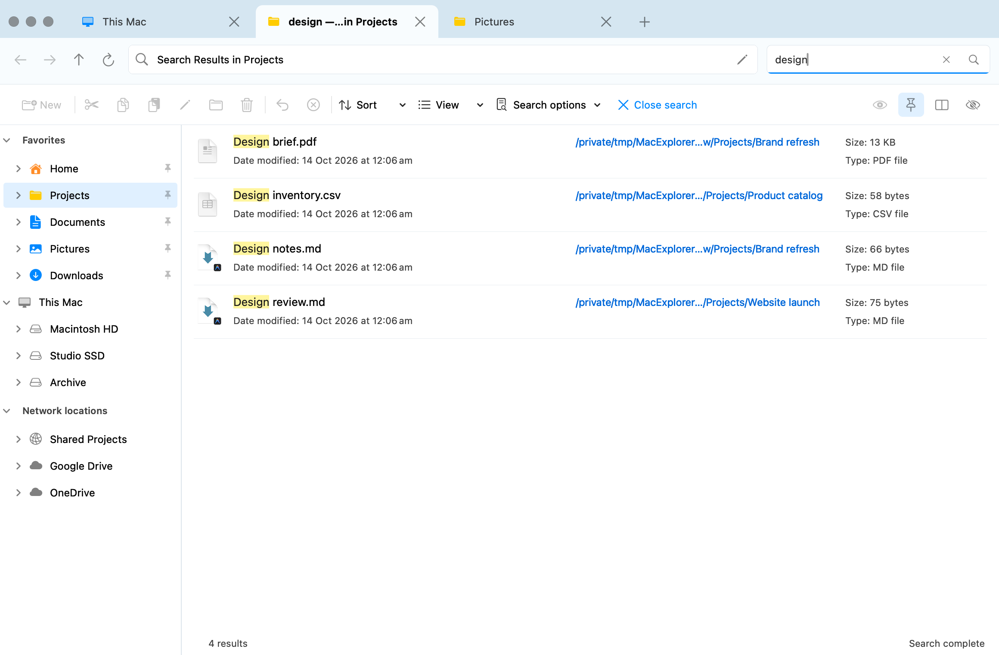
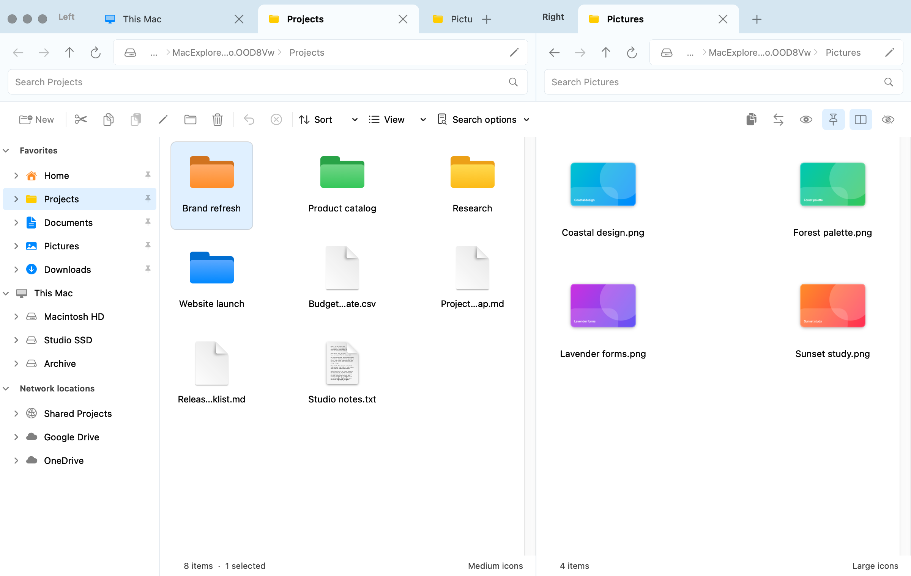

<p align="center">
  
</p>

# MacExplorer

A native macOS file manager for people who like Windows Explorer.

MacExplorer brings familiar tabs, a folder tree, drive overviews, and keyboard shortcuts to the Mac, with native Quick Look, thumbnails, and Finder color tags. Built with Swift and AppKit, with Sparkle for signed software updates.

**Early development · macOS 14+ · MIT licensed**



*All screenshots use fictional sample files, accounts, and storage figures.*

## What it can do

- **Browse your way:** tabs, tab reordering and detaching into windows, breadcrumbs, a folder tree, pinned favorites, and dual panes.
- **Manage files:** copy, cut, paste, move, rename, new folders, Trash, conflict handling, and undo. Drag files between folders, tabs, and panes.
- **Find things:** search filenames in a folder or its subfolders, highlight matches, and click a result's folder path to open it with the file selected.
- **Choose a view:** details, content, and multiple icon sizes; sort and group independently; preview files with Quick Look.
- **See your storage:** local and external drives, mounted network shares, and locally available cloud folders, including Google Drive.
- **Make it yours:** Finder color tags, light/dark appearance, startup and browsing preferences, optional launch at login, and a configurable global shortcut (⌘E by default).

## A closer look

Search results show the containing folder, modification date, size, and matching text.



Two panes make it easy to work across folders, with independent tabs and views.



## Build and run

You need **macOS 14 or later** and a **Swift 6 toolchain** from Xcode or Xcode Command Line Tools.

```sh
git clone https://github.com/binaryquest/MacExplorer.git
cd MacExplorer
zsh scripts/build.sh
open build/Explorer.app
```

The build script creates `build/Explorer.app`, generates its icon, embeds Sparkle, and applies a local ad-hoc signature. Automatic updates are disabled in source builds. The first signed, notarized public release is being prepared.

The app appears as **Explorer** in macOS. Open **Explorer → Settings…** to change the global shortcut, appearance, startup behavior, and browsing defaults. The global shortcut works while Explorer is running, including when its last window is closed; it can be changed or disabled if it conflicts with another app.

## Handy shortcuts

| Action | Shortcut |
| --- | --- |
| Bring Explorer forward | ⌘E (configurable) |
| Settings | ⌘, |
| New / close tab | ⌘T / ⌘W |
| Go to a path | ⌘L |
| Search / search subfolders | ⌘F / ⇧⌘F |
| Toggle dual panes / switch pane | ⇧⌘D / F6 |
| Quick Look | Space |
| Rename | F2 |
| Copy / cut / paste / undo | ⌘C / ⌘X / ⌘V / ⌘Z |
| New folder | ⇧⌘N |

Windows-style Ctrl+C/X/V/Z also work when the file list has focus.

## Current scope

MacExplorer is a standalone file manager. macOS still uses Finder for system integrations. Search currently matches filenames rather than file contents. Cloud folders come from providers already installed on your Mac; MacExplorer does not sign into cloud accounts or provide its own sync engine.

This is an early project under active development. Bug reports and small, focused pull requests are welcome—please include your macOS version and steps to reproduce. Use sample data in screenshots and reports.

## Development

```sh
zsh scripts/test.sh
```

`Sources/ExplorerCore` contains navigation, search, storage models, and file operations. `Sources/ExplorerApp` contains the native interface and macOS integrations. `Tests` covers the core behavior and AppKit interactions.

To create safe screenshots of your own, see [the demo guide](docs/SCREENSHOTS.md).

## Releases and updates

The release pipeline builds universal DMGs, signs them with Developer ID, submits them for Apple notarization, and publishes signed Sparkle updates through Cloudflare R2. Official builds include **Check for Updates…** and update preferences.

Initial hosting and notarization setup are still pending. Maintainers can follow the [release setup guide](docs/RELEASING.md).

Sparkle and its bundled components retain their [third-party licenses](Support/Licenses/Sparkle.txt).

## License

[MIT](LICENSE). Free to use, modify, and distribute, including commercially.

MacExplorer is an independent project, inspired by Windows Explorer and built for macOS. It is not affiliated with Microsoft or Apple.
